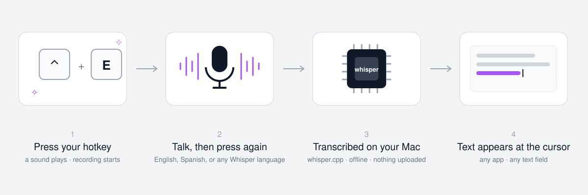

# ✧ Whisper Alternative



**Free, offline voice dictation for your Mac. Press a hotkey, talk, press it again, and the words appear wherever your cursor is.**

It uses [whisper.cpp](https://github.com/ggerganov/whisper.cpp) (OpenAI's Whisper models running on your own machine) and [Hammerspoon](https://www.hammerspoon.org) for the hotkeys. Nothing is uploaded anywhere, there is no subscription, and it works in every app. It plays a short sound when it starts and stops listening, so you always know whether it is recording.

> **The sound is yours to choose.** The sparkles are just the author's favourite, and the installer asks which sound you want. Pick another of the 7 included, any built-in Mac sound (`Tink`, `Pop`, `Glass`...), your own file, or no sound at all. You can change it any time: see [Change the sound](#change-the-sound).

Works in English, Spanish and the ~100 languages Whisper knows. You can give each language its own hotkey, or use one auto-detect hotkey and mix languages in a single take.

---

## Install (10 minutes, no coding needed)

> **Using Claude, Codex or another AI assistant?** Point it at this repo and say
> *"set up Whisper Alternative for me"*. The [CLAUDE.md](CLAUDE.md) file tells it exactly what to do and what to ask you.

**1. Open the Terminal app** (press `⌘ Space`, type `Terminal`, press Enter).

**2. Paste this line and press Enter.** It downloads the project and starts the installer:

```bash
[ -d ~/whisper_alternative ] || git clone https://github.com/vsancnaj/whisper_alternative.git ~/whisper_alternative; cd ~/whisper_alternative && ./install.sh
```

This puts the project in a `whisper_alternative` folder in your home folder. You can put it somewhere else (for example `~/Documents`) by changing both `~/whisper_alternative` in that line to the folder you prefer. The installer copies what it needs to `~/.config/whisper-alternative/`, so after it finishes you can delete the downloaded folder, or keep it for the sound preview and uninstall scripts.

If the Mac says `git` is missing, click **Install** in the window that pops up, wait for it to finish, then paste the line again.
If it says Homebrew is missing, the installer prints the line to install it. After Homebrew finishes, run the "Next steps" commands it prints, then paste the line above again. It is safe to repeat.

**3. Answer the questions.** Press Enter to accept a default. You pick:

| Question | Default |
|---|---|
| Start / stop sound | `sparkle_musicbox` / `sparkle_close` |
| Hotkey for English | `ctrl+e` |
| Other languages and their hotkeys | Spanish on `ctrl+s` |
| Hotkey for auto-detect | `ctrl+t` |
| Model size | `base` (fast). `small` is more accurate but 3x bigger |
| Menu bar icon | `♥` (any character, or `none`) |

The installer then downloads the Whisper models (150 MB each, a few minutes) and loads the hotkeys into Hammerspoon.

**4. Allow three permissions** (macOS asks once each):

- **Accessibility**: System Settings → Privacy & Security → Accessibility → turn on **Hammerspoon**. This lets it hear the hotkey and paste the text.
- **Microphone**: press your dictation hotkey once. macOS asks whether Hammerspoon may use the microphone. Click **Allow**.
- **Automation**: the first time text is pasted, macOS asks whether Hammerspoon may control **System Events**. Click **OK**. If you decline, the text is copied but not pasted.

If Hammerspoon was already running, click its menu bar icon → **Reload Config** so it picks up the new hotkeys.

Also tick **Launch Hammerspoon at login** in the Hammerspoon preferences so dictation is ready after a restart.

**5. Try it.** Click into any text field, press `ctrl+e`, wait for the sparkle, say something, press `ctrl+e` again. A heart `♥` in the menu bar means the hotkeys are loaded.

---

## Everyday use

| Press | What happens |
|---|---|
| hotkey once | sparkle sound, recording starts |
| hotkey again | closing sound, transcription runs (1 to 3 seconds), text is pasted at the cursor |
| hotkey twice within a second | ignored, so an accidental double-tap does nothing |

Pressing the hotkey to stop within the first second is ignored (recording carries on). The audio file is overwritten every time and lives only in `/tmp/whisper-alternative/`; the transcript is deleted right after pasting, and the log keeps only metadata, never your words. Pasting uses the clipboard, so whatever you had copied is replaced by the dictated text.

---

## Customise

Everything lives in one file: `~/.config/whisper-alternative/config.json`.
After any change, reload Hammerspoon (click its menu bar icon → **Reload Config**).

### Change a hotkey

Hotkeys are written as modifiers joined with `+`, ending with the key: `ctrl+e`, `alt+cmd+d`, `ctrl+shift+s`. Modifiers: `ctrl`, `alt` (Option), `cmd`, `shift`.

```json
"english": { "hotkey": "ctrl+shift+e", "language": "en", "model": "ggml-base.en.bin" }
```

### Add a language

Add a block under `"modes"`. `language` is the Whisper code (`fr`, `de`, `it`, `pt`, `nl`, `ja`, `zh`, `ko`, `ru`, ... or `auto`). Non-English languages need a multilingual model (one **without** `.en` in the name).

```json
"french": { "hotkey": "alt+cmd+f", "language": "fr", "model": "ggml-base.bin" }
```

Then run `./install.sh` again from the repo folder: it keeps your config and downloads any model that is missing.

### Change the sound

Seven sparkle sounds ship in `sounds/`. Listen to them with:

```bash
scripts/preview_sounds.sh
```

Set your picks in the config (file name without extension):

```json
"start_sound": "sparkle_warm",
"stop_sound": "sparkle_close"
```

**Use your own sound**: drop any `.wav`, `.aiff` or `.mp3` into `~/.config/whisper-alternative/sounds/` and use its name. Keep it under two seconds so it does not delay you. Any built-in macOS sound works too (`"Tink"`, `"Pop"`, `"Glass"`, ...). You can also synthesise a quick chime with sox, which the installer already put on your Mac:

```bash
sox -n ~/.config/whisper-alternative/sounds/my_chime.wav synth 0.15 sine 880 synth 0.15 sine 1320 fade 0.01 0.3 0.1
```

Set `"start_sound": ""` to disable a sound.

### Pick a bigger or smaller model

| Model | Size | Speed | Use when |
|---|---|---|---|
| `ggml-base.en.bin` | 150 MB | fastest | English only (default) |
| `ggml-base.bin` | 150 MB | fast | other languages / auto-detect (default) |
| `ggml-small.bin` | 490 MB | ok | accents, noisy rooms, technical words |
| `ggml-large-v3-turbo.bin` | 1.6 GB | slower | best accuracy, Apple Silicon with 16 GB+ |

Change `"model"` in a mode and re-run `./install.sh` to download it. Any file from the [whisper.cpp model list](https://huggingface.co/ggerganov/whisper.cpp/tree/main) works.

### Optional: "generate" mode with a local LLM

The config includes a disabled `generate` mode. Instead of transcribing word for word, it sends what you said to a local [Ollama](https://ollama.com) model as an instruction ("write a polite email declining the meeting") and pastes the result. To use it:

```bash
brew install ollama && ollama serve &
ollama pull qwen2.5:0.5b
```

Then set `"enabled": true` on the `generate` mode and reload Hammerspoon. If Ollama is not running, the raw transcription is pasted instead.

### Other settings

| Key | Meaning |
|---|---|
| `menubar_icon` | character shown in the menu bar (`""` to hide) |
| `min_record_seconds` | ignore stop presses before this many seconds |
| `mic_gain_db` | boost applied to the microphone (lower it if audio clips) |
| `"enabled": false` on a mode | keep it in the file but do not bind its hotkey |
| `"prompt"` on a mode | words to prime Whisper with (names, jargon, "use proper punctuation.") |

---

## What gets installed where

| Path | What |
|---|---|
| `~/.config/whisper-alternative/config.json` | your settings (the only file you edit) |
| `~/.config/whisper-alternative/dictate.py` | records, transcribes, pastes (Python standard library only) |
| `~/.config/whisper-alternative/models/` | Whisper model files |
| `~/.config/whisper-alternative/sounds/` | your sounds |
| `~/.hammerspoon/whisper_alternative.lua` | reads the config and binds the hotkeys |
| `~/.hammerspoon/init.lua` | gets one added line: `whisperAlternative = require("whisper_alternative")` |
| `/tmp/whisper-alternative/` | the current recording, transcript and `dictate.log` |

Homebrew packages: `whisper-cpp`, `sox`, and the `hammerspoon` cask.

## Troubleshooting

Run the diagnostics first. It tells you exactly what is missing:

```bash
~/.config/whisper-alternative/dictate.py --check
```

| Symptom | Fix |
|---|---|
| Hotkey does nothing, no sound | Hammerspoon is not running, or lacks Accessibility permission. Open Hammerspoon, check System Settings → Privacy & Security → Accessibility. |
| Sound plays but nothing is pasted | Microphone permission was denied. System Settings → Privacy & Security → Microphone → enable Hammerspoon. Also check `/tmp/whisper-alternative/dictate.log`. |
| Text pasted into the wrong place | The cursor moved while you were talking. Click where you want the text before pressing the hotkey the second time. |
| Wrong language transcribed | You used an English-only `.en` model for another language, or the auto mode guessed wrong. Give the language its own mode. |
| Hotkey conflicts with an app shortcut | Change the hotkey in `config.json` (for example `ctrl+s` saves in some editors). |
| First transcription is slow | The model loads from disk on first use. Later runs are faster. |
| A red alert says "Whisper Alternative failed" | The message after the colon says why (usually a missing model). Run `~/.config/whisper-alternative/dictate.py --check` or read `/tmp/whisper-alternative/dictate.log`. |
| Text is copied but not pasted | The Automation permission was declined. System Settings → Privacy & Security → Automation → Hammerspoon → turn on System Events. |

## Uninstall

```bash
scripts/uninstall.sh
```

Removes the config, models, sounds and the Hammerspoon line. Homebrew packages stay unless you remove them (the script prints the command).

## Credits

Built on [whisper.cpp](https://github.com/ggerganov/whisper.cpp) by Georgi Gerganov, [Hammerspoon](https://www.hammerspoon.org), and [SoX](https://sourceforge.net/projects/sox/). Sparkle sounds made with Claude. MIT licensed.
